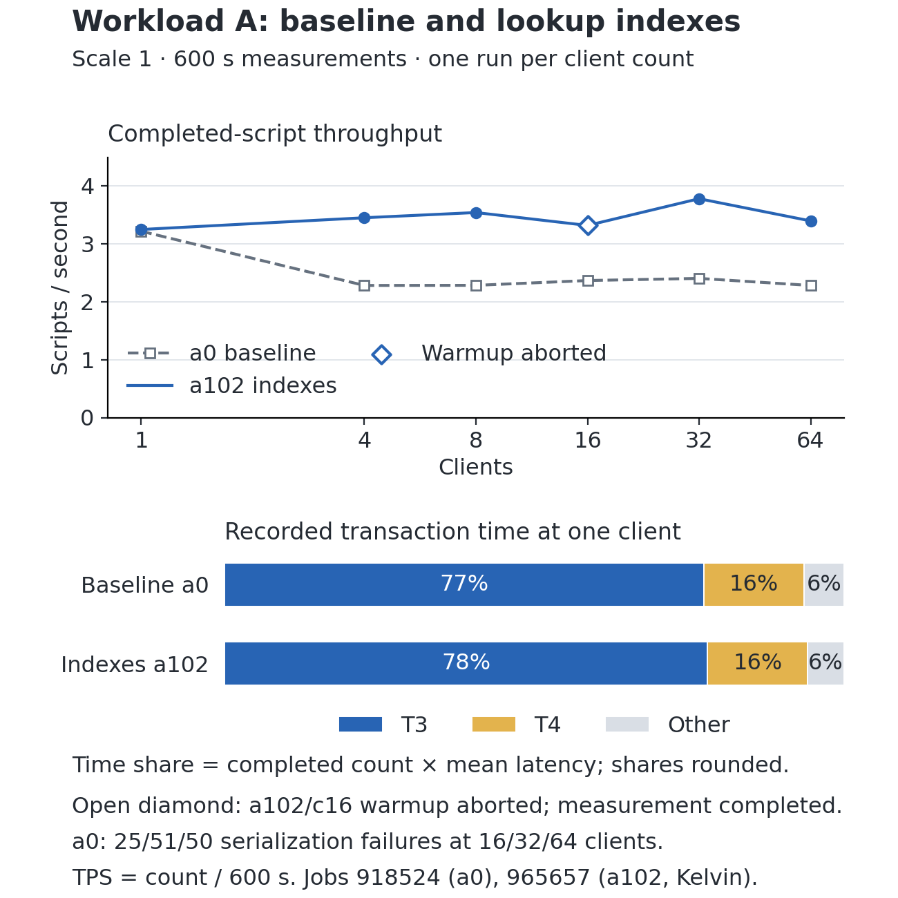
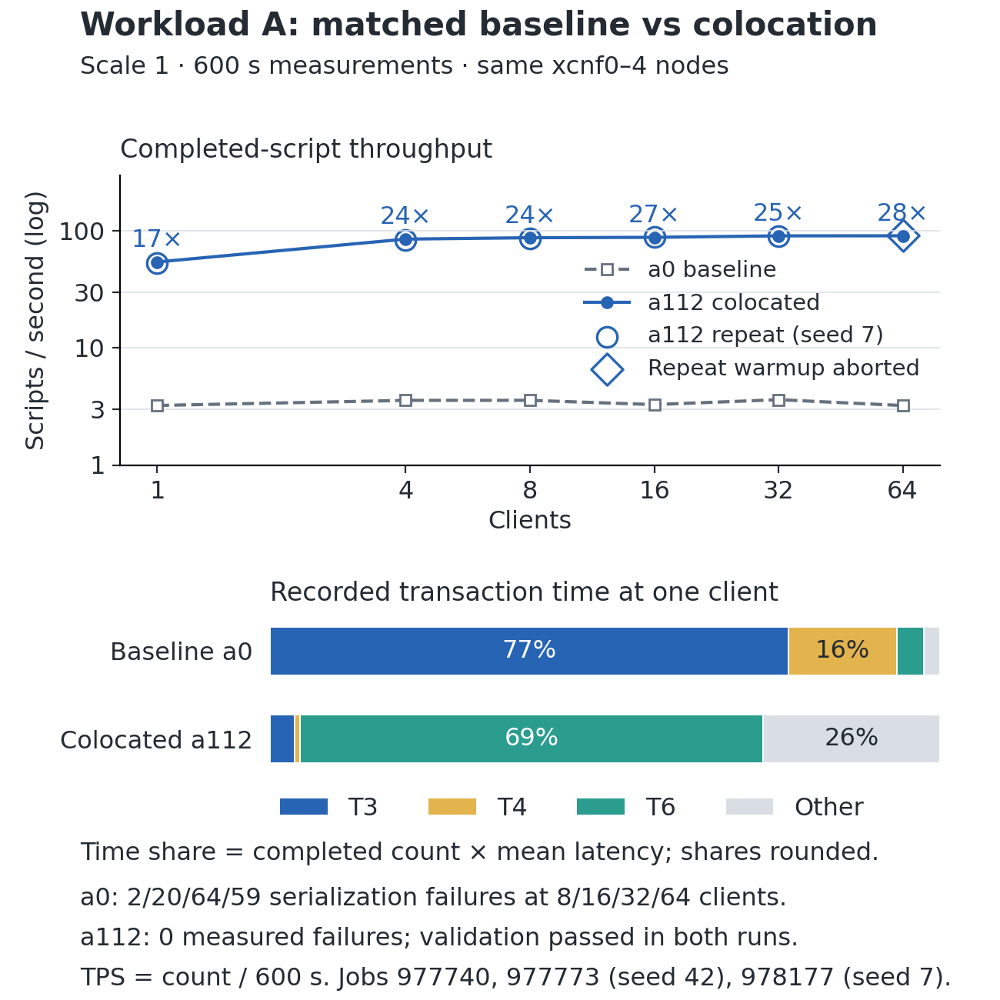

# Draft report sections 2–3: Workload A

Prepared 19 October 2026. This is a working draft; a112 is the provisional design
(repeated on two seeds); team review and the a114 diagnostic remain open. Kelvin's a102/a10/a11/a12/a14 source update is
preserved in `results/team-update-20261019/kelvin-update.json`. After SSH access
was restored, his raw folders were retrieved and reviewed in
`results/cluster-import-20261019/`. New diagnostic jobs are recorded in `results/cluster/`.

## 2. Task 1: Baseline design for workload A

### 2.1 Environment and workload

The preserved baseline, `expt_a0`, ran as Slurm job 918524 on five xcnf nodes:
one coordinator and four workers. It used PostgreSQL 18.6 and Citus 14.1.0,
scale 1, SERIALIZABLE isolation, 60-second warmup, 600-second measurements,
and full transaction-log sampling. The coordinator was xcnf8. Each node received
four CPUs. The database settings included shared_buffers 1GB, work_mem 32MB and
an adaptive executor pool limit of 4.

The workload weights for T1–T9 were 36/20/10/10/10/5/5/2/2 percent.
Orders and items were distributed by their individual generated identifiers,
while inventory was distributed by inventory_id. Although the distribution-key
types permitted a shared colocation group, the joins did not consistently match
those distribution keys. Merchant/customer filters therefore did not make the
order-history join local to one worker.

### 2.2 Baseline results

Values below come from the preserved job's `summary.csv`, not the local pilot.
TPS is completed pgbench scripts divided by configured measurement duration.
Completed scripts can include expected business rejections.

| Clients | TPS | p50 ms | p95 ms | p99 ms | Retried transactions | Serialization failures | pgbench exit |
|---:|---:|---:|---:|---:|---:|---:|---:|
| 1 | 3.220 | 11.009 | 2654.656 | 2698.524 | 0 | 0 | 0 |
| 4 | 2.283 | 22.897 | 15398.450 | 18331.968 | 1 | 0 | 0 |
| 8 | 2.285 | 34.815 | 29532.561 | 32842.913 | 13 | 0 | 0 |
| 16 | 2.368 | 41.305 | 52999.831 | 58194.283 | 49 | 25 | 0 |
| 32 | 2.405 | 41.395 | 92368.465 | 100724.606 | 67 | 51 | 0 |
| 64 | 2.283 | 54.925 | 180370.276 | 187011.576 | 62 | 50 | 0 |

At one client, T3 averaged 2678.797 ms, T4 458.862 ms, and T7 51.114 ms.
Throughput did not scale with additional clients, while tail latency increased
substantially. The 16/32/64-client cases completed with nonzero serialization
failure counts. These failures must remain visible in the comparison even
though pgbench returned zero.

A fresh a0 control (job 977740, xcnf0–4, same settings) completed 3.225/3.565/
3.568/3.282/3.613/3.222 TPS at 1/4/8/16/32/64 clients, with 0/0/2/20/64/59
serialization failures and all pgbench exits zero. One-client results match
918524, but the fresh control is 41–56% higher at 4+ clients. The cause is not
established; node placement and cluster load differ. Optimized designs are
therefore compared against the matched fresh control in section 3.7.

The results suggest prioritizing T3/T4 data access and placement before further
optimizing short update transactions. Query plans from the new cluster runs
are still needed to verify the execution mechanism directly for A.
Weighting each transaction's observed mean latency by its completed count,
T3/T4 account for approximately 93.6% of recorded transaction time at one client
and 97.2% at 64 clients. This is a time-share calculation, not their workload weights.

## 3. Task 2: Optimized design for workload A

### 3.1 Individual designs

Hikaru implemented five design angles as seven individual variants and a
combined design. All preserve the workload mix and required isolation.

| Experiment | Change | Purpose or tradeoff |
|---|---|---|
| a101 | Merchant-based placement and matching join predicates | Reduce distributed work; examine hot-merchant contention and cross-merchant work. |
| a102 | Order lookup, order-item and inventory lookup indexes | Reduce lookup cost; measure write overhead and remaining distributed joins. |
| a103 | One-call T1 function | Reduce round trips while preserving atomic stock/order/item changes and business rollback. |
| a104 | Exact daily sales summaries | Reduce T6 scanning while maintaining totals synchronously inside T1. |
| a105 | work_mem 64MB | Isolate a memory-setting change from placement and SQL changes. |
| a106/a107 | Executor pool 2/8 | Compare worker concurrency with the baseline limit of 4. |
| a108 | Placement + indexes + T1 function + sales summaries | Measure interactions between changes. |

The native distributed correctness suite passed 138 checks on the original
variants, including rejected orders, duplicate products, rollback after partial
work, competing orders, transfers, generated IDs, order totals and exact reports.
The original short local pilot completed 16 of 18 cases. a101 aborted during
four-client warmup and a108 during four-client measurement. Their partial
performance measurements are excluded from comparisons.

### 3.2 Verified course-cluster evidence from Kelvin's experiments

Kelvin ran a102 unchanged from commit 82058e6 as job 965657, with results under
`/home/stuproj/cs14/citus_project/expt_a102`. On retrieval, all 12 source files
matched that version and the saved runtime hashes. The topology was xcnf1
coordinator and xcnf2–5 workers, with recorded PostgreSQL 18.6/Citus 14.1.0,
scale 1 and the original benchmark settings. All six measured-phase pgbench
exits are zero, with zero measured serialization failures and six passing core
validation records. The 16-client warmup nevertheless exited 2; that observation
is flagged and excluded from clean-run comparisons. Other a102 warmups exited zero.

| Clients | a0 TPS | a102 TPS | Observed gain |
|---:|---:|---:|---:|
| 1 | 3.220 | 3.250 | 0.93% |
| 4 | 2.283 | 3.453 | 51.25% |
| 8 | 2.285 | 3.543 | 55.05% |
| 16* | 2.368 | 3.320 | 40.20% |
| 32 | 2.405 | 3.782 | 57.26% |
| 64 | 2.283 | 3.398 | 48.84% |

*The 16-client measurement completed after an aborted warmup. These are
single-run observations, not confidence estimates. The observed range
from four clients upward is 40–57%, refining the approximate teammate-reported
40–65%. Nodes differ within the same xcnf family; matched repetitions are still needed.

**Correction after the fresh control.** Against fresh a0 job 977740, a102's clean
throughput differences are +0.8/−3.1/−0.7/+4.7/+5.5% at 1/4/8/32/64 clients. Most
of the apparent 40–57% gain therefore reflects a difference between baseline runs,
not the indexes. a102's supported benefits are zero serialization failures (versus
20/64/59 at 16/32/64 clients in the fresh control) and lower T7 latency.

The hollow point flags the completed 16-client measurement after an aborted
warmup. Clean concurrent observations (4/8/32/64 clients) show 49–57% gains.
The figure is reproducible with `python3 scripts/plot_a_baseline_comparison.py`;
the SVG, reviewed data and chart contract are retained beside the PNG.

The retrieved T7 one-client average latency falls from 51.114 to 13.709 ms,
but T3/T4 remain 2668.472/454.362 ms. Weighting completed counts by mean latency,
those two transactions account for 94.05% of recorded time at one client.
This supports testing colocation as the next step rather than expecting lookup
indexes alone to remove distributed joins.

Kelvin's separate experiments on top of a102 are a10 (autocommit T2/T5/T8/T9),
a11 (fillfactor 80), a12 (synchronous_commit off), and a14 (VACUUM only).
The downloaded full matrices show no consistent material overall TPS gain.
a10's 32-client measurement has pgbench exit 2 and is excluded from eligible TPS.
a11's zero-retry observation needs repetition. a14 records one serialization
failure at 32 clients. These are Kelvin's experiments and should be attributed
accordingly in contributions. All 30 imported cases are indexed in case-review.csv;
six core validation records per job do not make the aborted a10 case or the
a102/c16 aborted warmup eligible for clean-run comparison.

### 3.3 Follow-up: read-only access declarations

The team B report describes a reduction in client aborts after declaring T3/T4/T6
READ ONLY. To test that hypothesis independently for A, a109 derives from a101
and a110 from a108, changing only those three BEGIN statements to BEGIN READ
ONLY. Their query bodies, write transactions, isolation, retry limit, workload
weights and durability settings are unchanged. No DEFERRABLE mode is added.
The new Slurm scripts select xcnf hardware; all submissions through the helper
now do so as well. Hardware selection is recorded separately from the SQL change.

READ ONLY is an access mode, independent of the isolation level. It does not
guarantee that SERIALIZABLE transactions will avoid all serialization failures.
The original failed variants are preserved for matched comparisons.

On 19 October, the follow-up local test reproduced four-client aborts in a101,
a108, a109 and a110. The read-only variants passed 64 correctness checks in total,
but did not resolve the benchmark failures. No partial TPS from these aborted
runs is used as a performance result.

### 3.4 Alternative: colocate on the join keys

a111 adapts Dessi's B b1/b2 placement changes to A on top of a102. Inventory is
distributed by product_id and colocated with products; order_items is distributed
by order_id and colocated with orders. T7 retains the selected inventory ID and
adds its corresponding product ID to each update's routing predicate. This does
not assume that inventory_id equals product_id. a112 changes only T3/T4/T6's access
declarations to READ ONLY relative to a111. Dessi's original design contribution
and Hikaru's A adaptation are both recorded in the experiment manifests.

Both variants passed 29 correctness checks each, including T7 with inventory IDs
deliberately different from product IDs, actual distribution/colocation metadata,
and the real read transaction scripts. T3/T4/T6 EXPLAIN ANALYZE plans for a112
were captured on the small correctness fixture. Performance validation is recorded
separately from that fixture; these checks do not establish course-cluster speedup.
Both a111 and a112 aborted during the local four-client warmup. Together with
the four merchant-colocation cases above, all six follow-up stress cases failed.
All 40 post-failure integrity checks passed. No failed TPS is used in a ranking;
these local failures remain separate from the subsequent course-scale diagnostics.

### 3.5 Safe read-only snapshots as a separate test

a113 adds READ ONLY DEFERRABLE to a112's T3/T4/T6, without changing their query
bodies or lowering isolation. PostgreSQL permits these read-only transactions
to wait for a safe snapshot. This mode was tested separately from a109–a112.
a113 passed 29 correctness checks, but the four-client local warmup still
aborted, including a T2 shard-commit failure. All five post-failure integrity
checks passed. No performance gain or general fix is claimed.

### 3.6 Course diagnostics and validation cost

The xcnf smoke suite tested a102/a101/a111/a112 at one/four clients. Five cases
completed both phases; all three optimized placement variants aborted at four
clients, while the a102 control completed. All eight post-measurement core
validation records passed. These tests use scale 0.01 and short durations and
must remain separate from full results.

a101 then ran at scale 1/four clients with 60-second warmup and measurement
(job 977468). Both phases aborted. Its original global-ID validation remained
active on the coordinator for over eleven minutes after worker aggregation had
finished. The query plan underestimates the final number of global-ID groups.
An equivalent exact COUNT(DISTINCT) validator checked the same full dataset in
25.753 seconds. Seven regression checks demonstrated acceptance of valid data,
rejection of duplicate global order/item IDs and wrong totals, and acceptance
after restoration. The original job was cancelled only after independent exact
validation passed; dependent jobs were cancelled before starting.

This repair affects post-measurement validation only. Benchmark SQL, isolation,
workload mix, retries and timing are unchanged. Runtime hashes identify the
validator used in each attempt. Revised scale-1/four-client diagnostics for
a111/a112/a113 are jobs 977617/977618/977619. They use the original 60-second
warmup, a diagnostic 60-second measurement and a fresh initial dataset without
a redundant reload for the single client count.

All three revised jobs completed both phases with exit zero, no measured failed
records, serialization failures or retries, and passing exact validation. a111
completed 5395 scripts (89.917 TPS), a112 5543 (92.383 TPS), and a113 5433
(90.550 TPS), using completed scripts divided by the configured 60 seconds.
Their pgbench elapsed-time TPS was 89.347/91.951/89.755 respectively. Runtime
hashes match the retrieved code. These single short observations show eligibility
for further testing, not a reliable ranking or a demonstrated general concurrency
fix. The smaller-fixture failures remain preserved.

### 3.7 Matched full comparison: a0 versus a112

Fresh a0 control 977740 and a112 candidate 977773 ran consecutively on the same
explicitly requested nodes (xcnf0 coordinator, xcnf1–4 workers) with scale 1,
1/4/8/16/32/64 clients, 60-second warmups, 600-second measurements, data resets
between client counts, pgbench seed 42 and full log sampling. All 12 warmup and
measured pgbench exits are zero. a112 recorded six passing post-run validations;
the unmodified a0 script has no validation step.

| Clients | a0 TPS | a112 TPS | Ratio | a0 p95 ms | a112 p95 ms | a0 / a112 serialization failures |
|---:|---:|---:|---:|---:|---:|---:|
| 1 | 3.225 | 54.238 | 16.8× | 2645.3 | 19.7 | 0 / 0 |
| 4 | 3.565 | 85.042 | 23.9× | 9822.8 | 313.6 | 0 / 0 |
| 8 | 3.568 | 87.378 | 24.5× | 19276.3 | 978.3 | 2 / 0 |
| 16 | 3.282 | 88.073 | 26.8× | 36030.5 | 2407.6 | 20 / 0 |
| 32 | 3.613 | 90.660 | 25.1× | 64187.6 | 623.0 | 64 / 0 |
| 64 | 3.222 | 90.788 | 28.2× | 128104.3 | 6597.9 | 59 / 0 |

a112 retried 0/0/2/2/5/16 transactions; every retry succeeded, so no transaction
failed. At one client, T3 falls from 2656.9 to 6.8 ms and T4 from 454.5 to 1.5 ms,
consistent with order_items now being colocated with orders and inventory with
products, so the order-history and product-lookup joins run on a single worker.
T7 falls from 51.7 to 5.3 ms. T6 is unchanged at about 257–263 ms because it
still aggregates across every shard.

The bottleneck has moved. Weighted by completed count × mean latency, T3+T4
account for 93.5–97.7% of a0's recorded time, while T6 accounts for 67–83% of
a112's. a112's throughput plateaus near 85–91 TPS from four clients, and at 64
clients T3's mean rises to 1.69 s. T6 is the next optimization target; a104's
exact daily sales summaries address it, but the combined a108 aborted locally,
so any a112 + summaries variant needs separate correctness and stress testing.

A repeat of a112 with pgbench seed 7 (job 978177, same nodes and settings)
reproduced the result within 2.5% at every client count: 52.970/82.947/86.530/
89.152/90.105/91.123 TPS, zero failed measured transactions and six passing
validations. Its 64-client warmup, however, aborted one client: a single-shard
T1 COMMIT on worker xcnf2 was cancelled by SERIALIZABLE as a dependency pivot,
and the Citus coordinator reported it as a generic shard-commit failure rather
than a serialization failure, so pgbench did not retry it. That case is flagged
and excluded, consistent with a102/c16. The same wrapped commit-time conflict
likely explains the local four-client aborts at higher contention; it is a
residual risk of a112 under heavy load, not a correctness violation.
Pending candidate 977741 was replaced before starting to correct its node request.

**Provisional selection:** a112 (a102 lookup indexes + join-key colocation of
inventory/products and order_items/orders + READ ONLY T3/T4/T6) is the leading
Workload A design. Two matched seeds agree; final selection awaits Kelvin's
agreement and the a114 (T6 summary) diagnostic before the 23 October cutoff. Local timing and teammate-reported cluster numbers remain
separate from these independently verified measurements.

## Sources to retain in the final report

- Preserved expt_a0 job 918524: config.txt, summary.csv, transaction_metrics.csv,
  topology and server versions in the repository.
- Kelvin's supplied update, indexed in results/team-update-20261019/kelvin-update.json.
- Native correctness and local pilot records in results/.
- [PostgreSQL 18 SET TRANSACTION](https://www.postgresql.org/docs/18/sql-set-transaction.html).
- [Citus colocation](https://github.com/citusdata/citus/blob/main/README.md#creating-distributed-tables-with-co-location).

## Hikaru contribution draft

Designed and implemented A variants a101–a113 (including adaptation of Dessi's
B placement design for a111–a113); built experiment generation,
distributed correctness checks, local benchmark infrastructure and submission
helpers; preserved evidence and failures; established the public team repository;
reviewed cluster evidence, repaired exact post-run validation, ran course
diagnostics, drafted A analysis and coordinated packaging. Kelvin ran cluster a102 and owns
a10/a11/a12/a14. Dessi supplied original A/B baselines and the B experiment/report
work. Confirm full names and remaining contributions with the team before submission.
